<p align="center">
  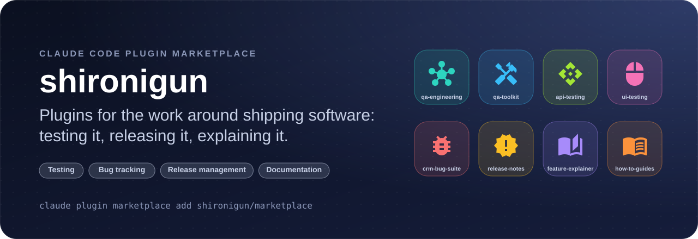
</p>

<p align="center">
  <a href="#the-catalog"></a>
  <a href="https://code.claude.com/docs/en/plugins/overview"></a>
  <a href="#trust--safety"></a>
  <a href="#trust--safety"></a>
</p>

<p align="center">
  <a href="#the-catalog"><b>Catalog</b></a> ·
  <a href="#which-plugin-for-which-job"><b>Which plugin?</b></a> ·
  <a href="#quick-start"><b>Quick start</b></a> ·
  <a href="#install"><b>Install</b></a> ·
  <a href="#trust--safety"><b>Trust &amp; safety</b></a> ·
  <a href="#contributing-a-plugin"><b>Contributing</b></a>
</p>

A [Claude Code](https://code.claude.com/docs/en/plugins/overview) **plugin marketplace**: a curated set of
plugins (skills, agents, commands and MCP servers) for the work around shipping software. **Test it**, track
what broke, **ship it** with release notes customers read, and **explain it** with pages and guides. Install
them into Claude Code in the terminal, the Claude desktop app, or the VS Code extension.

The flagship is **[qa-engineering](plugins/qa-engineering/)**: one AI orchestrator for the whole QA loop
(analyze a story → author and approve test cases → publish them to a Test Plan/Suite → generate API + UI
automation → turn a failing run into a filed bug) with **a human gate at every tracker write**.

> **Marketplace name:** `shironigun` · **Source:** `shironigun/marketplace` (this repo)
> When you install a plugin you refer to it as **`<plugin>@shironigun`** (the `@` uses the marketplace's
> registered name, not the GitHub path).

## Why teams use it

| | |
|---|---|
| **You stay in control** | Nothing is created, filed or published in your tracker until you confirm a preview. Research is read-only. |
| **No secrets in the repo** | Sign-in is your `az login` session or an interactive browser sign-in. Your product details live in your own git-ignored files. |
| **Built from real work** | Every plugin came out of a real QA, release or documentation workflow and keeps the lessons from its reviews. |
| **Install only what you need** | Each plugin stands alone. Pick one job, or take the whole QA loop. |

---

## The catalog

Select a card to open that plugin's folder and its README.

<table>
  <tr>
    <td width="50%" valign="top">
      <a href="plugins/qa-engineering/">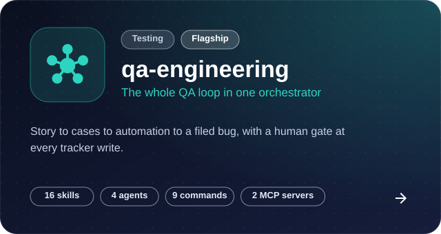</a>
      <br><b><a href="plugins/qa-engineering/">qa-engineering</a></b>: the flagship. Story → cases → publish → automate → run → bug, human-gated, and it teaches and reviews the framework too.
      <br><code>claude plugin install qa-engineering@shironigun</code>
    </td>
    <td width="50%" valign="top">
      <a href="plugins/qa-toolkit/">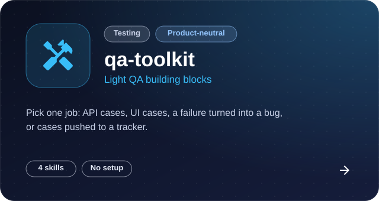</a>
      <br><b><a href="plugins/qa-toolkit/">qa-toolkit</a></b>: à-la-carte QA jobs. API cases, UI cases, a failure turned into a bug, cases pushed to your tracker.
      <br><code>claude plugin install qa-toolkit@shironigun</code>
    </td>
  </tr>
  <tr>
    <td width="50%" valign="top">
      <a href="plugins/api-testing/">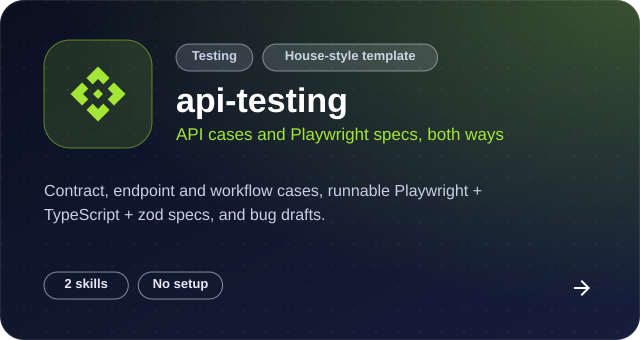</a>
      <br><b><a href="plugins/api-testing/">api-testing</a></b>: contract, endpoint and workflow cases, runnable Playwright + TypeScript + zod specs, and review-ready bug drafts.
      <br><code>claude plugin install api-testing@shironigun</code>
    </td>
    <td width="50%" valign="top">
      <a href="plugins/ui-testing/">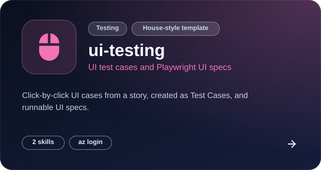</a>
      <br><b><a href="plugins/ui-testing/">ui-testing</a></b>: click-by-click UI cases created as Azure DevOps Test Cases, and runnable Playwright UI specs.
      <br><code>claude plugin install ui-testing@shironigun</code>
    </td>
  </tr>
  <tr>
    <td width="50%" valign="top">
      <a href="plugins/crm-bug-suite/">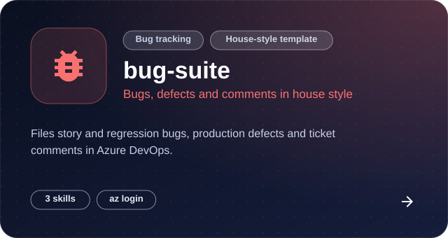</a>
      <br><b><a href="plugins/crm-bug-suite/">crm-bug-suite</a></b>: files story and regression Bugs, production Defects and ticket comments in a defined house style.
      <br><code>claude plugin install crm-bug-suite@shironigun</code>
    </td>
    <td width="50%" valign="top">
      <a href="plugins/release-notes-suite/">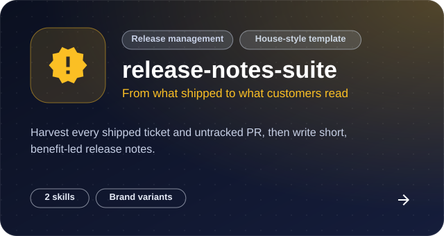</a>
      <br><b><a href="plugins/release-notes-suite/">release-notes-suite</a></b>: harvest everything that shipped (tracked or not), then write short, benefit-led release notes.
      <br><code>claude plugin install release-notes-suite@shironigun</code>
    </td>
  </tr>
  <tr>
    <td width="50%" valign="top">
      <a href="plugins/feature-explainer/">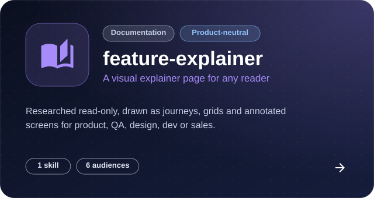</a>
      <br><b><a href="plugins/feature-explainer/">feature-explainer</a></b>: name a feature and a reader; get a researched, visual explainer page for product, QA, design, dev or sales.
      <br><code>claude plugin install feature-explainer@shironigun</code>
    </td>
    <td width="50%" valign="top">
      <a href="plugins/how-to-guides/">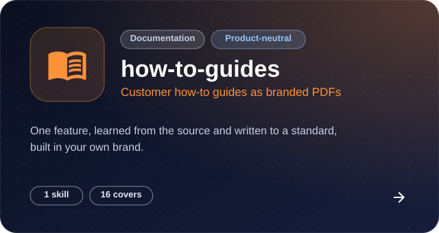</a>
      <br><b><a href="plugins/how-to-guides/">how-to-guides</a></b>: complete customer guides for one feature, written to a standard and built as a PDF in your own brand.
      <br><code>claude plugin install how-to-guides@shironigun</code>
    </td>
  </tr>
</table>

### At a glance

| Plugin | Category | Skills | What it writes | Setup | Product-neutral |
|---|---|---|---|---|---|
| [qa-engineering](plugins/qa-engineering/) | Testing | 16 skills, 4 agents, 9 commands | Test Cases, suites and bugs in Azure DevOps, each after your OK; framework code in your repo | Set `ADO_ORG`; interactive sign-in | Yes |
| [qa-toolkit](plugins/qa-toolkit/) | Testing | 4 | Cases and bug drafts in the session; Test Cases in your tracker (Azure DevOps, Jira, Linear and more) | A tracker connector, only to push cases | Yes |
| [api-testing](plugins/api-testing/) | Testing | 2 | Cases, spec files and bug drafts in the session | None | Template |
| [ui-testing](plugins/ui-testing/) | Testing | 2 | Test Case work items (`buggy`, after your OK); UI specs in the session | `az login` for `buggy` | Template |
| [crm-bug-suite](plugins/crm-bug-suite/) | Bug tracking | 3 | Bugs, Defects and comments in Azure DevOps | `az login` | Template |
| [release-notes-suite](plugins/release-notes-suite/) | Release management | 2 | An inventory and release-note drafts in the session | An Azure DevOps connection to harvest tickets | Template |
| [feature-explainer](plugins/feature-explainer/) | Documentation | 1 | A private artifact page you choose to share | Node.js, Python 3 | Yes |
| [how-to-guides](plugins/how-to-guides/) | Documentation | 1 | A PDF guide on your machine | Node.js, Chrome | Yes |

**Product-neutral** plugins ship no product data: your tracker, product and brand live in your own config.
**Templates** are tuned to one team's project and house style; retarget the conventions in each skill's
`references/` folder for yours.

## See it in action

Every plugin has a picture of one real job: what you ask on the left, what you get back on the right.
Here is the flagship. The rest are under [The plugins in detail](#the-plugins-in-detail), and at the top of each plugin's README.

<p align="center"><a href="plugins/qa-engineering/">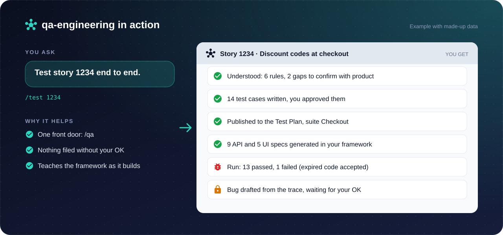</a></p>

---

## Which plugin for which job

<p align="center">
  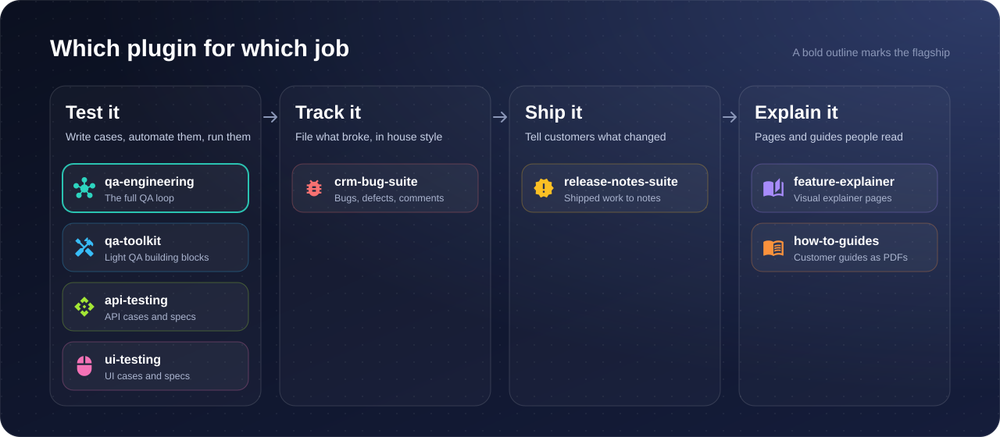
</p>

- **Building QA from scratch, or want one front door?** Start with **[qa-engineering](plugins/qa-engineering/)** and type `/qa`.
- **Need one QA job done, no setup?** **[qa-toolkit](plugins/qa-toolkit/)**, or **[api-testing](plugins/api-testing/)** and **[ui-testing](plugins/ui-testing/)** for scripts.
- **Filing what broke in a team's house style?** **[crm-bug-suite](plugins/crm-bug-suite/)**.
- **Telling customers what shipped?** **[release-notes-suite](plugins/release-notes-suite/)**.
- **Explaining a feature?** A page for your team: **[feature-explainer](plugins/feature-explainer/)**. A PDF for your customers: **[how-to-guides](plugins/how-to-guides/)**.

## How it works

<p align="center">
  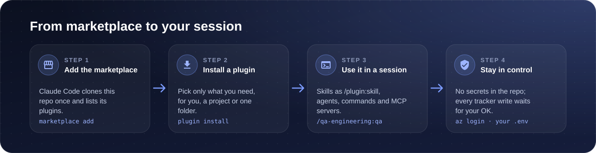
</p>

---

## Quick start

```bash
# 1. Add this marketplace (clones the repo into Claude Code)
claude plugin marketplace add shironigun/marketplace

# 2. Install a plugin — e.g. the flagship
claude plugin install qa-engineering@shironigun

# 3. Start (or restart) a Claude Code session, then use it
#    In a session, its skills appear as /qa-engineering:<skill>
```

New skills/agents load at the start of a session. If you installed mid-session, run `/reload-plugins` or
start a new session.

---

## Install

### A. Claude Code CLI (terminal)

```bash
# add the marketplace (pin a branch/tag with shironigun/marketplace#<ref> if you want)
claude plugin marketplace add shironigun/marketplace

# install one or more plugins (default scope: user — just you, on this machine)
claude plugin install qa-engineering@shironigun
claude plugin install qa-toolkit@shironigun

# verify
claude plugin marketplace list          # shows "shironigun"
claude plugin list                       # shows installed plugins + enabled status
claude plugin details qa-engineering@shironigun   # lists its skills, agents, MCP servers
```

Manage them:

```bash
claude plugin disable qa-engineering@shironigun
claude plugin enable  qa-engineering@shironigun
claude plugin update  qa-engineering@shironigun     # after: claude plugin marketplace update shironigun
claude plugin uninstall qa-engineering@shironigun
claude plugin marketplace remove shironigun          # removes the marketplace + its installed plugins
```

**Scope:** add `--scope project` to an install to write the enable entry into the repo's committed
`.claude/settings.json` (so collaborators can install it too); `--scope local` keeps it to this repo for
just you. Default is `--scope user`.

**In a running session** the same operations are available as slash commands:

```
/plugin marketplace add shironigun/marketplace
/plugin install qa-engineering@shironigun
/reload-plugins
/plugin                    # opens the panel: Discover · Installed · Marketplaces · Errors
```

`/plugin install …` opens the plugin's details and asks you to pick a scope (user / project / local) before
it installs.

<details>
<summary><b>B. Claude desktop app (Code tab)</b></summary>

The desktop plugin browser installs **from marketplaces you've already added**, so add this marketplace once
from a terminal (step A above) — there is no documented GUI form for *adding* a marketplace. Then, in a
**local** session (not a cloud session):

1. Click the **+** button next to the prompt box → **Plugins**.
2. **Add plugin** → pick `qa-engineering` (or any plugin) from the list → choose a scope (your account /
   this project / local-only).
3. Manage or remove later via **+** → **Plugins** → **Manage plugins**.
4. If new skills don't show up, type `/reload-plugins` in the prompt box, or start a new session.

> Plugins are not available in cloud or WSL sessions; use a native local session. (In the **VS Code**
> extension you can do everything from the prompt box: type `/plugins` → **Marketplaces** tab to add this
> marketplace, then the **Plugins** tab to install.)

</details>

<details>
<summary><b>C. From a local clone (offline / development)</b></summary>

```bash
git clone https://github.com/shironigun/marketplace.git
claude plugin marketplace add ./marketplace            # a folder containing .claude-plugin/marketplace.json
claude plugin install qa-engineering@shironigun
```

A local-path marketplace is read in place (not copied). After you `git pull`, run `/reload-plugins` or start
a new session. Don't add both the GitHub copy and a local copy at once — both register as `shironigun`;
remove one first (`claude plugin marketplace remove shironigun`).

</details>

---

## The plugins in detail

Each heading links to the plugin's folder, where its README has the full guide.

### [qa-engineering](plugins/qa-engineering/) — the flagship

**One orchestrator for the entire QA loop**, keeping you in control at every tracker write. You bring intent
and context; it routes to the engine that owns the work:

| You say… | It runs |
|---|---|
| "Analyze story #1234" | **story-intelligence** — reads the ADO work-item graph → understanding + open gaps (read-only) |
| "Create test cases" | **author-api-cases / author-ui-cases** — house-style cases + an explicit approval gate |
| "Push these to ADO" | **ado-publish** — pick Test Plan/Suite → dry-run → **confirm** → create + add-to-suite + link |
| "Automate these cases" | **automation-engine** — approved/ADO cases → Playwright + TS specs, reusing the framework standards |
| "Turn this red run into a bug" | **failure-to-bug** — investigate an API/UI failure (trace/screenshot) → classify → **gated** bug file |
| "Build a framework brick by brick" | **scan-and-confirm → kit-builder** — a guided API+UI framework build, phase by phase |
| "Teach me automation" / "review my framework" | **automation-tutor** / **framework-reviewer** |

- **Human-gated:** nothing is created or filed in your tracker until you confirm a preview — it never
  auto-pushes cases or bugs.
- **Product-neutral & self-contained:** ships no product data; your tracker, product, voice, auth and URLs
  live in a git-ignored `house-profile.json` + `.env` in your own framework folder.
- **Ships two MCP servers** (Playwright + Azure DevOps), version-pinned; both sign in locally, no tokens in
  the repo.

Start it by invoking the **`qa-orchestrator`** agent and saying what you want, or invoke a skill directly
(e.g. `kit-builder` for the build). See [its README](plugins/qa-engineering/) and
[`docs/`](plugins/qa-engineering/docs/) for the full map, and the
[end-to-end rehearsal](plugins/qa-engineering/docs/enhancement/end-to-end-rehearsal.md) for a trace of the whole loop.

<p align="center"><a href="plugins/qa-engineering/"></a></p>

<details>
<summary><b>How qa-engineering works</b></summary>
<br>
<p align="center">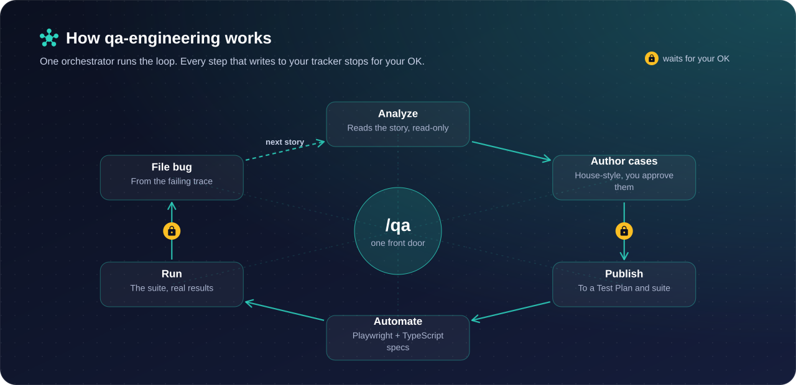</p>
</details>

### [qa-toolkit](plugins/qa-toolkit/)

Product-neutral QA building blocks: generate API and UI test cases, convert test failures into bugs, and
push them to your tracker. The lightweight, à-la-carte alternative to `qa-engineering`'s full orchestration.

<p align="center"><a href="plugins/qa-toolkit/">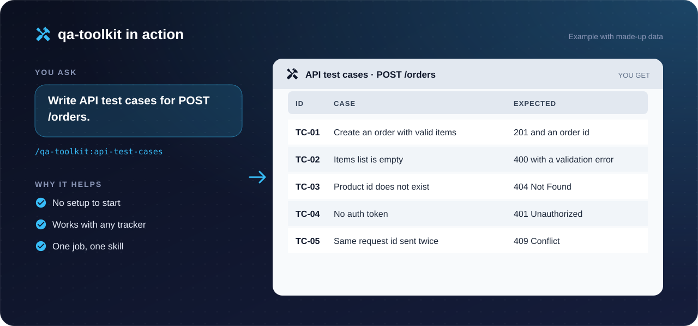</a></p>

<details>
<summary><b>How qa-toolkit works</b></summary>
<br>
<p align="center">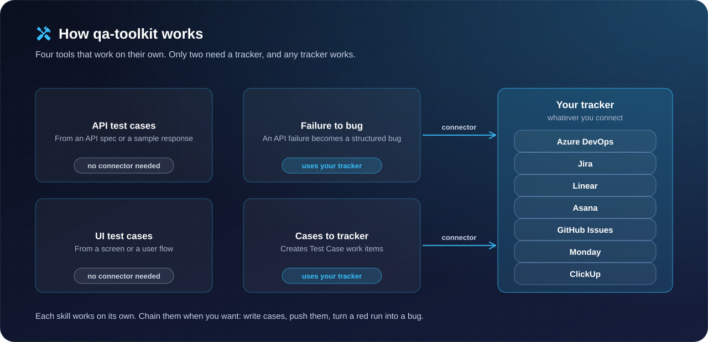</p>
</details>

### [api-testing](plugins/api-testing/)

`api-tester` authors contract / endpoint / workflow API cases and generates runnable Playwright + TypeScript
specs (forward from cases, or reverse from existing specs); `api-bugger` triages a failed API test and drafts
a review-ready bug. (Tuned to a specific product's conventions.)

<p align="center"><a href="plugins/api-testing/">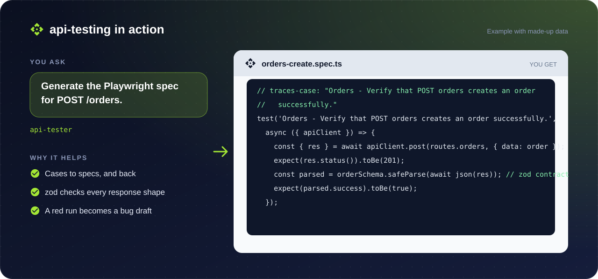</a></p>

<details>
<summary><b>How api-testing works</b></summary>
<br>
<p align="center">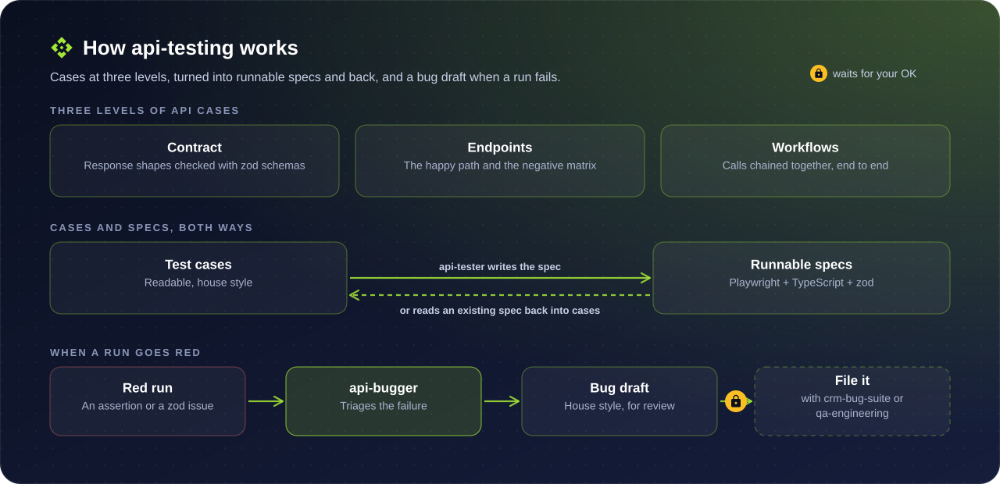</p>
</details>

### [ui-testing](plugins/ui-testing/)

`buggy` writes ADO Test Case work items in a house style; `tester` authors UI cases and generates runnable
Playwright + TypeScript UI specs (forward and reverse). (Tuned to a specific product.)

<p align="center"><a href="plugins/ui-testing/">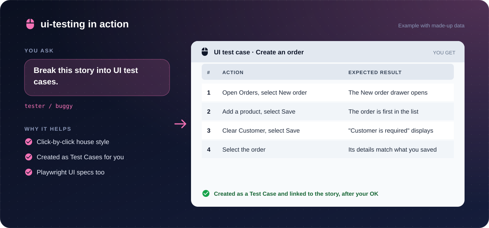</a></p>

<details>
<summary><b>How ui-testing works</b></summary>
<br>
<p align="center">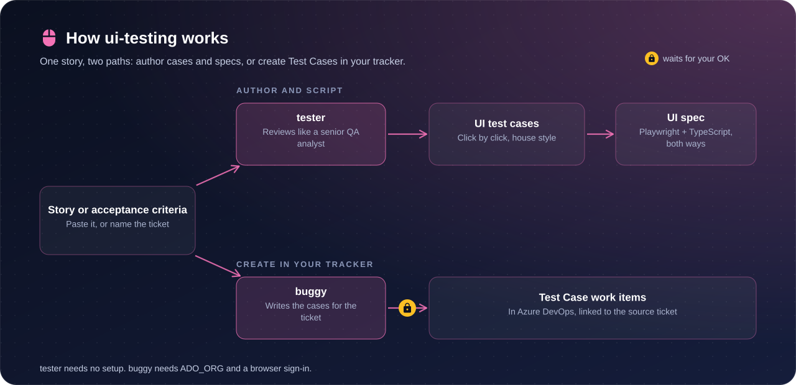</p>
</details>

### [crm-bug-suite](plugins/crm-bug-suite/)

Files **Bugs** (against stories / regression) and **Defects** (production) and writes ticket comments on a
specific "Agile Project" Azure DevOps project, in a defined QA house style.

<p align="center"><a href="plugins/crm-bug-suite/">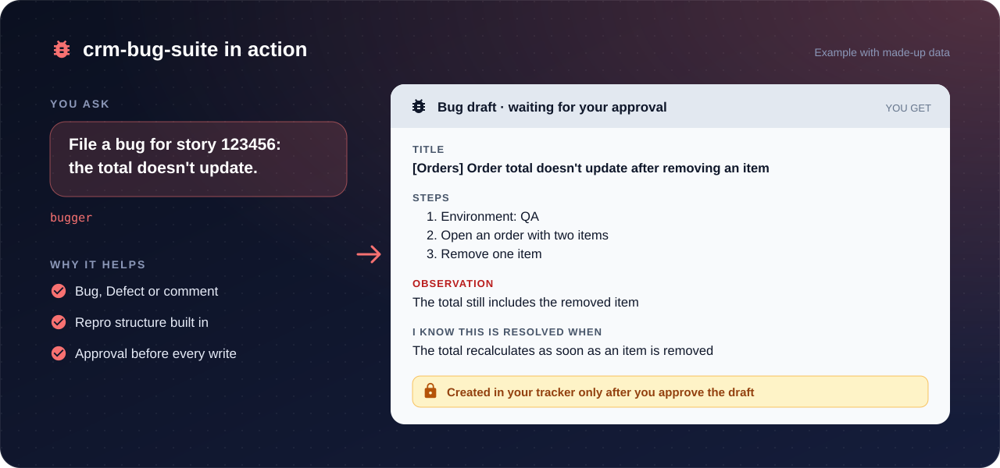</a></p>

<details>
<summary><b>How crm-bug-suite works</b></summary>
<br>
<p align="center">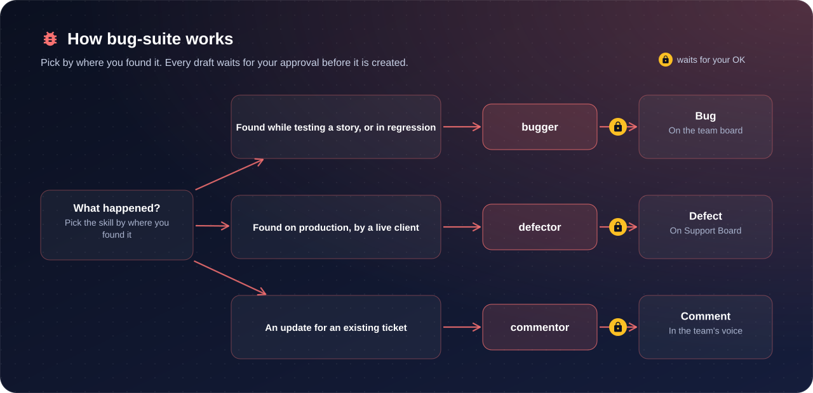</p>
</details>

### [release-notes-suite](plugins/release-notes-suite/)

A two-stage release pipeline: **harvester** builds the complete engineering release inventory (every shipped
story/defect across boards, plus non-ticketed PR/commit deployments); **releaser** turns that inventory (or a
technical draft) into audience-facing release notes, with brand variants.

<p align="center"><a href="plugins/release-notes-suite/">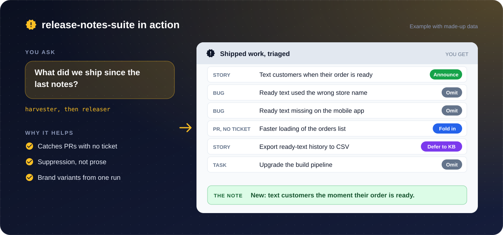</a></p>

<details>
<summary><b>How release-notes-suite works</b></summary>
<br>
<p align="center">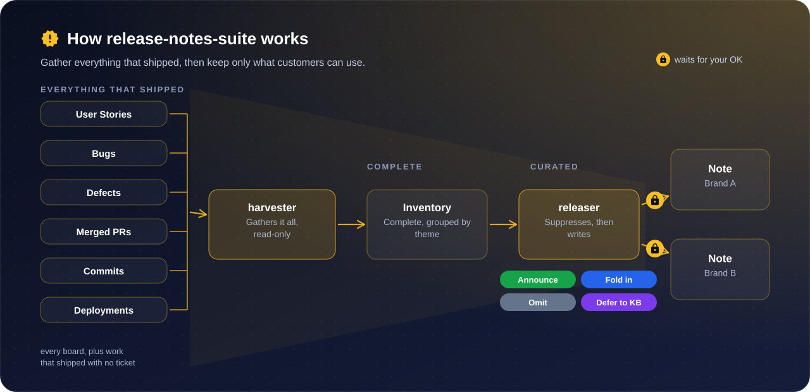</p>
</details>

### [feature-explainer](plugins/feature-explainer/)

Give one line of direction ("explain the refund flow") and **feature-explainer** researches the feature
read-only (code, branches, tickets, docs, live calls when you allow them), then publishes a multi-page
artifact for the reader you name: product, QA, design, development, sales/operations or everyone. Each
edition leads with what that reader needs (journeys and decisions, testable rules, screens and states,
architecture and contract, or a customer-facing overview) as pictures, with the right detail collapsed or
left out, and an audience-aware lint checks it before it is built. Bundles a drawing kit, a build script and
layout checks.

<p align="center"><a href="plugins/feature-explainer/">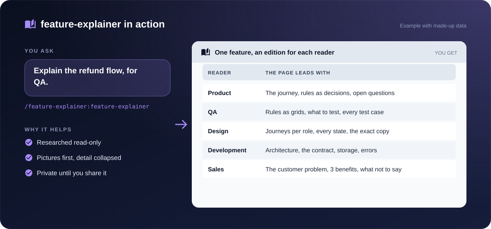</a></p>

<details>
<summary><b>How feature-explainer works</b></summary>
<br>
<p align="center">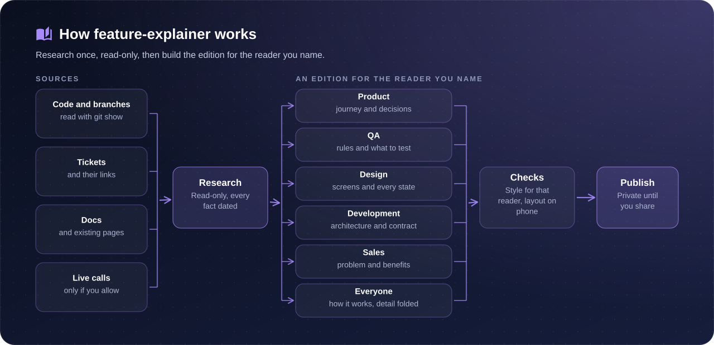</p>
</details>

<p align="center"><a href="plugins/feature-explainer/">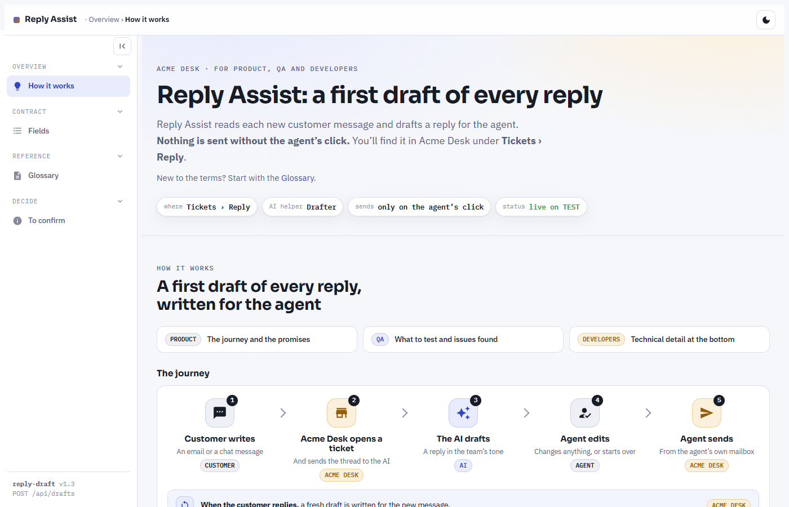</a></p>

### [how-to-guides](plugins/how-to-guides/)

Name a feature and **how-to-guide** writes the complete customer guide for it: what it does, how it works,
every task as checked steps, the questions readers ask and what to do when something goes wrong. It learns
the feature from the code and the app (read-only), keeps lists of open questions, change requests and bugs
for product, and builds a branded PDF from Markdown with checks against the standard. Your logo, colours,
font and house rules live in your own `howto-brand.json`, never in the plugin.

<p align="center"><a href="plugins/how-to-guides/">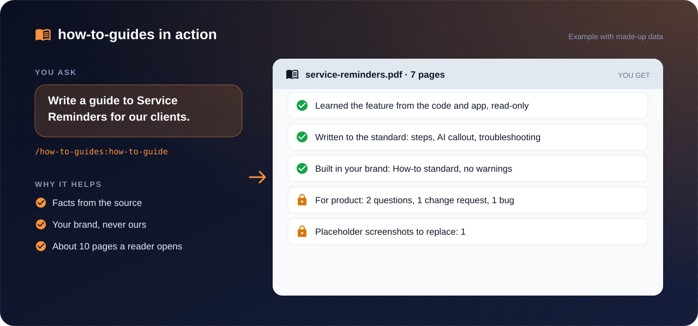</a></p>

<details>
<summary><b>How how-to-guides works</b></summary>
<br>
<p align="center">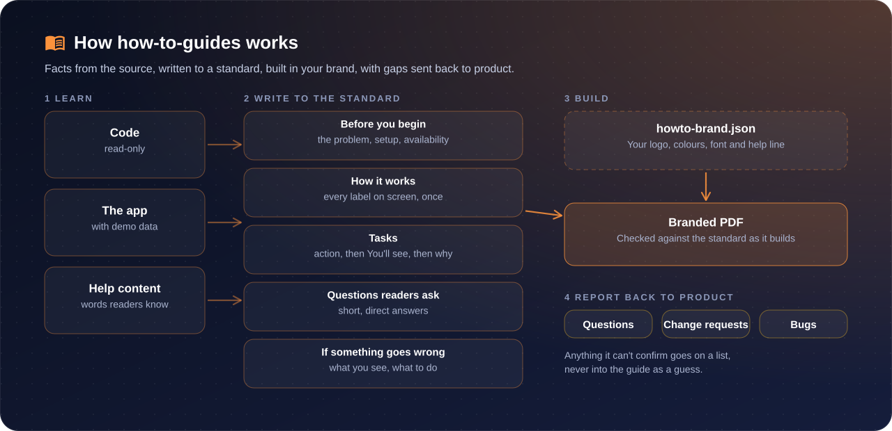</p>
</details>

<p align="center"><a href="plugins/how-to-guides/">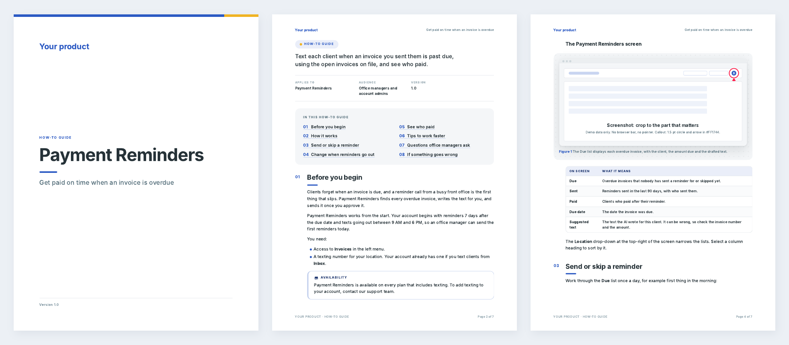</a></p>

---

### Requirements (MCP servers) — all self-contained, no secrets

Every plugin is self-contained. Most work the moment they install — they produce test cases, scripts, notes,
pages, guides or drafts **in the session** with no external dependency: `qa-toolkit`, `release-notes-suite`,
`api-testing`, `feature-explainer` and `how-to-guides`.

The three plugins that **write to Azure DevOps** each **bundle their own ADO MCP server** (in the plugin's
`.mcp.json`) — **no PAT or token is committed or required**, and there's no manual MCP config:

- **`crm-bug-suite`** (files Bugs/Defects/comments) and **`ui-testing`** (its `buggy` skill creates
  Test Cases) bundle the `azure-devops` MCP with **Azure Identity** auth → just run **`az login`** once.
- **`qa-engineering`** ships the official Azure DevOps + Playwright MCP servers with **interactive** sign-in
  → just set **`ADO_ORG`** in the shell that launches Claude Code.

No tokens live anywhere in this repo. Auth is your `az login` session or an interactive browser sign-in.
(Each ADO plugin defaults to a placeholder org; change `AZURE_DEVOPS_ORG_URL` in its `.mcp.json`
for yours. The bundled servers use a Windows `cmd /c npx` launcher — each README has the one-line
macOS/Linux swap.)

---

## After install — how it loads

- **Skills & commands** appear as `/<plugin>:<skill>` in a session. `claude plugin details <plugin>@shironigun`
  lists everything a plugin provides.
- **Agents** become available for Claude to delegate to; **hooks** run at their lifecycle events; **MCP
  servers** from an enabled plugin start automatically and show in `/mcp` (their tools are named
  `mcp__plugin_<plugin>_<server>__<tool>`). Toggle a server off in `/mcp` without uninstalling.
- Changes apply at **session start** or after **`/reload-plugins`** (MCP-server changes apply on the next
  session).
- **Where things live** (user scope, `~` = your home dir): enable state in `~/.claude/settings.json`; the
  marketplace clone in `~/.claude/plugins/marketplaces/shironigun/`; installed copies in
  `~/.claude/plugins/cache/shironigun/<plugin>/…`.
- **Updates** are not automatic for a third-party marketplace: run `claude plugin marketplace update shironigun`
  then `claude plugin update <plugin>@shironigun`, or enable auto-update in `/plugin` → Marketplaces →
  `shironigun`.

## Trust & safety

Plugins run with **your** privileges — hooks, MCP servers, and any `bin/` on the Bash PATH. Install only
plugins you trust. Before installing, you can read a plugin's `.mcp.json`, `hooks/`, and `bin/` in this repo.
The plugins here keep **no secrets in the repo**: Azure DevOps signs in interactively (set `ADO_ORG` in the
shell that launches Claude Code) or through your `az login` session, and framework credentials live in your
own git-ignored `.env`. See the [plugin security docs](https://code.claude.com/docs/en/plugins/security).

| Guarantee | How |
|---|---|
| Nothing is written to your tracker without you | Every create, publish and file step shows a preview and waits for your OK. |
| Research doesn't change anything | The documentation plugins read code, branches and tickets read-only: no commits, pushes or branch switches. |
| Your data stays yours | Product, tracker, brand and credentials live in your own git-ignored files, never in this repo. |
| Screenshots use demo data | `how-to-guides` takes shots from a local or test build and refuses any other host unless you allow it. |

## Contributing a plugin

1. Create `plugins/<your-plugin>/`.
2. Add `.claude-plugin/plugin.json` (`name`, `version`, `description`, `author`).
3. Add your skills / agents / commands / `.mcp.json` under the plugin directory, plus a short `README.md`.
4. Add one entry to `.claude-plugin/marketplace.json` (`name`, `description`, `source`, `category`).
5. Add a row to `PLUGINS` in [`assets/readme/generate.mjs`](assets/readme/generate.mjs) (its own colour, an
   icon, a tagline and its steps), run `node assets/readme/generate.mjs`, and add its card to
   [the catalog](#the-catalog) and its banner to the top of its README.
6. Keep it **product-neutral and secret-free** where possible; put any product/tracker specifics behind a
   git-ignored config file, never in committed files.
7. Open a PR into `main`.

## Docs

- Per-plugin: `plugins/<plugin>/README.md` and `plugins/<plugin>/docs/`.
- Claude Code plugins: [overview](https://code.claude.com/docs/en/plugins/overview) ·
  [install](https://code.claude.com/docs/en/plugins/install) ·
  [CLI reference](https://code.claude.com/docs/en/plugins/cli-reference) ·
  [marketplaces](https://code.claude.com/docs/en/plugins/create-marketplace)

<p align="center"><sub>Made by <a href="https://github.com/shironigun">shironigun</a> · Plugins for testing, releasing and explaining software</sub></p>
