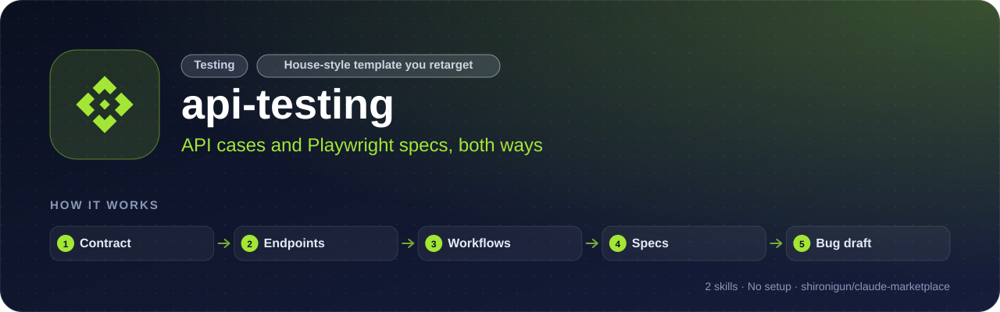
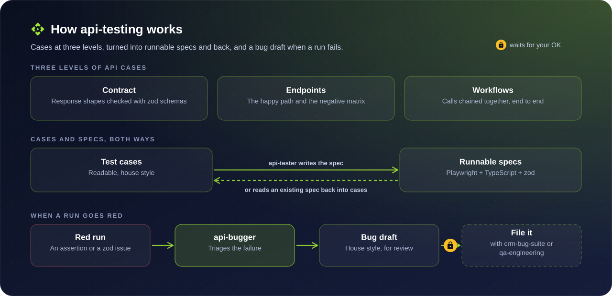

# api-testing

<p align="center">
  
</p>

<p align="center">
  <a href="../../README.md#the-catalog">← All plugins</a> ·
  <a href="#install">Install</a> ·
  <a href="../../README.md#trust--safety">Trust &amp; safety</a>
</p>

| At a glance | |
|---|---|
| **Category** | Testing |
| **What it does** | API cases and runnable Playwright + TypeScript + zod specs, both ways, plus bug drafts |
| **Includes** | 2 skills |
| **Writes** | Nothing outside the session: cases, specs and drafts |
| **Setup** | None |
| **Product-neutral** | Yes: org facts come from a local workspace profile |

## See it in action

<p align="center"></p>

## How it works at a glance

<p align="center"></p>


API test-case authoring and Playwright + TypeScript + zod **script generation** for any HTTP API,
plus failed-test bug drafting, in a rigorous senior-QA house style.

| Skill | What it does | Needs an MCP? |
|---|---|---|
| **api-tester** | Authors API test cases at three levels — **Contract** (zod schema verification), **Endpoints** (happy + the negative matrix), **Workflows** (API chaining / the E2E equivalent) — **and** generates/parses runnable Playwright + TS + zod scripts, working **both ways** (cases → scripts and scripts → cases). | No — authoring + script generation only |
| **api-bugger** | When an API script goes red, triages the failure and **drafts** a house-style ADO Bug to review now and push later. Draft-and-review only; it never auto-pushes. | No — drafts to the automation project's `find-bugs` module |

Trigger by asking for API test cases/scripts or by pasting a failed API test's output — e.g.
"write API tests for POST /orders", "generate the Playwright spec for this endpoint", "turn this spec file
into test cases", "the contract test failed, write it up".

## Prerequisites

**None for the plugin itself** — both skills produce their output in the session (test cases, runnable
spec files, or a bug draft). To actually **file** a drafted bug into Azure DevOps afterward, you can use
an optional companion plugin from this marketplace (**bug-suite** or **qa-engineering**); those plugins
**bundle** their own ADO MCP (Azure Identity / `az login`, no token), so filing works with no extra setup. The generated scripts target the Playwright + TypeScript + zod automation framework;
running them is done in that framework (`npx playwright test`), not through this plugin.

## Workspace profile (your org facts stay local)

Neither skill ships any org's facts. On first run each skill reads (or discovers, read-only, and asks you
to confirm) a local **workspace profile** at `.claude/workspace-profile.json` in your project: modules,
environments, integration partners (variants) and the route param that carries the tenant id, plus, for
`api-bugger`, the tracker project, board area paths, the org's Bug fields and the filer's identity. It is
git-ignored and never committed. The schema is in each skill's `references/workspace-profile.md`.

## Install

```bash
claude plugin marketplace add shironigun/marketplace
claude plugin install api-testing@shironigun
```

## Notes

- Product-neutral: org facts come from the workspace profile, and every route, schema and partner name in
  the skills' examples is a fictional placeholder (`orders`, `OrderRoutes`, `PARTNER-A`).
- Optional companion plugins in this marketplace: **ui-testing** (the click-by-click UI equivalent) and
  **bug-suite** (filing Bugs/Defects to ADO). For the full QA loop — story → cases → publish → automate →
  bug — in one orchestrator, see **qa-engineering**.
