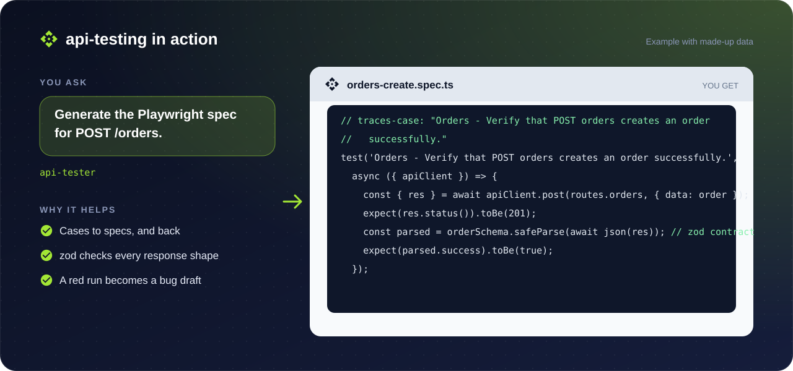

# api-testing

<p align="center">
  
</p>

<p align="center">
  <a href="../../README.md#the-catalog">← All plugins</a> ·
  <a href="#install">Install</a> ·
  <a href="../../README.md#trust--safety">Trust &amp; safety</a>
</p>

| At a glance | |
|---|---|
| **Category** | Testing |
| **What it does** | API cases and runnable Playwright + TypeScript + zod specs, both ways, plus bug drafts |
| **Includes** | 2 skills |
| **Writes** | Nothing outside the session: cases, specs and drafts |
| **Setup** | None |
| **Product-neutral** | Template: retarget `references/` |

## See it in action

<p align="center"></p>

## How it works at a glance

<p align="center"></p>


API test-case authoring and Playwright + TypeScript + zod **script generation** for **Acme APP**
(Acme), plus failed-test bug drafting, in the team's QA house style.

| Skill | What it does | Needs an MCP? |
|---|---|---|
| **api-tester** | Authors API test cases at three levels — **Contract** (zod schema verification), **Endpoints** (happy + the negative matrix), **Workflows** (API chaining / the E2E equivalent) — **and** generates/parses runnable Playwright + TS + zod scripts, working **both ways** (cases → scripts and scripts → cases). | No — authoring + script generation only |
| **api-bugger** | When an API script goes red, triages the failure and **drafts** a house-style ADO Bug (in the team's voice) to review now and push later. Draft-and-review only; it never auto-pushes. | No — drafts to the automation project's `find-bugs` module |

Trigger by asking for API test cases/scripts or by pasting a failed API test's output — e.g.
"write API tests for POST /deals", "generate the Playwright spec for this endpoint", "turn this spec file
into test cases", "the contract test failed, write it up".

## Prerequisites

**None for the plugin itself** — both skills produce their output in the session (test cases, runnable
spec files, or a bug draft). To actually **file** a drafted bug into Azure DevOps afterward, hand it to a
filing skill (**bug-suite**'s `bugger`/`defector`, or **qa-engineering**'s gated `failure-to-bug`) —
those plugins **bundle** their own ADO MCP (Azure Identity / `az login`, no token), so filing works with no
extra setup. The generated scripts target the Acme APP Playwright + TypeScript + zod automation framework;
running them is done in that framework (`npx playwright test`), not through this plugin.

## Install

```bash
claude plugin marketplace add shironigun/marketplace
claude plugin install api-testing@shironigun
```

## Notes

- Tuned to Acme APP's automation framework and the team's house style.
- Sibling plugins: **ui-testing** (the click-by-click UI equivalent) and **bug-suite** (filing
  Bugs/Defects to ADO). For the full product-neutral QA loop — story → cases → publish → automate → bug — in
  one orchestrator, see **qa-engineering**.
