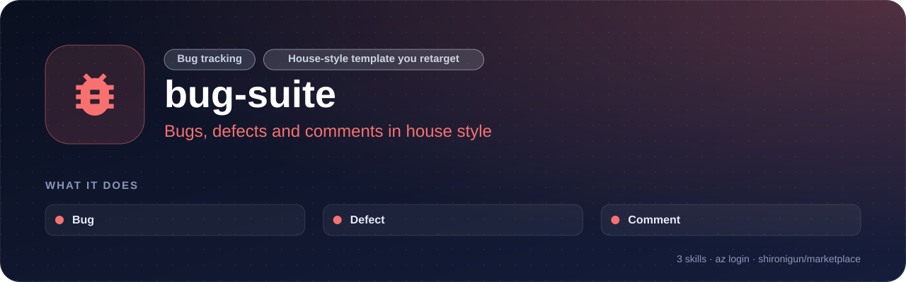
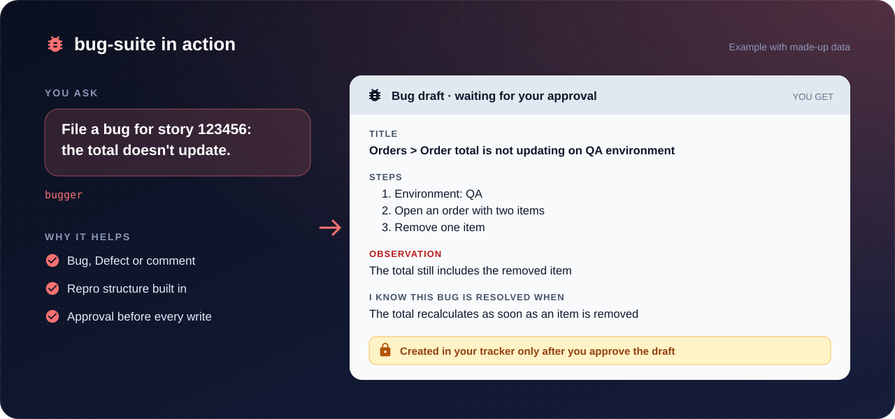
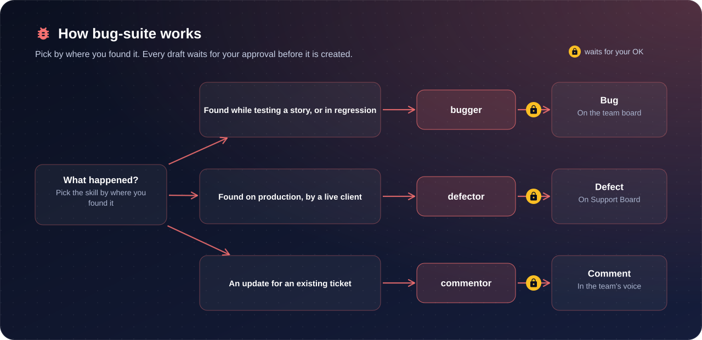

# Bug Suite

<p align="center">
  
</p>

<p align="center">
  <a href="../../README.md#the-catalog">← All plugins</a> ·
  <a href="#install">Install</a> ·
  <a href="../../README.md#trust--safety">Trust &amp; safety</a>
</p>

| At a glance | |
|---|---|
| **Category** | Bug tracking |
| **What it does** | Story and regression Bugs, production Defects and ticket comments |
| **Includes** | 3 skills |
| **Writes** | Bugs, Defects and comments in Azure DevOps, after your OK |
| **Setup** | `AZURE_DEVOPS_ORG_URL` + `az login` |
| **Product-neutral** | Yes: org facts are discovered into a local workspace profile on first run |

## See it in action

<p align="center"></p>

## How it works at a glance

<p align="center"></p>


Three skills for any Azure DevOps project, each following the same QA house style.

| Skill | Files what | Board / type | Trigger examples |
|-------|-----------|--------------|------------------|
| **bugger** | A **Bug** found while testing a story or during regression (QA/Staging) | delivery board · `Bug` | "file a bug for story 1001", "log this regression", "raise a bug on QA" |
| **defector** | A **Defect** found on **production**/live clients | support board · `Defect` | "log a production defect", "file a defect for the live issue", "raise a support defect" |
| **commentor** | A **comment** on any work item, in the house voice | any | "comment on 1001", "post an update/RCA on this ticket", "CC the dev team" |

## How the skills relate

- **bugger** creates **Bug** work items against a Story or a regression and parents them to the Story.
- **defector** is bugger's production sibling: same voice, different work-item type, board, and field taxonomy.
- **commentor** handles discussion/`System.History` updates on existing tickets.
- Optional companion: the **ui-testing** plugin in this marketplace writes UI test cases and files them as Test Case work items in the same tracker.

## Workspace profile (discovered on first run)

Nothing about your org ships in the plugin. On first run each skill reads `.claude/workspace-profile.json`
in your project; if keys it needs are missing, it does a **read-only** scan of your tracker (and codebase,
if present), shows you what it found, and saves it only after you confirm. The file is meant to be
git-ignored and never holds secrets. The schema is in each skill's `references/workspace-profile.md`.

What gets discovered and reused:

- **Tracker and boards:** org, project, the delivery board (story/regression bugs) and the support board (production defects).
- **Fields per type:** every custom field actually populated on your Bugs and Defects, with typical values. A field seen only on Defects is treated as Defect-only: always filled on Defects, never set on Bugs.
- **Identity:** who files and owns QA items — asked, never guessed.
- **Integration partners, modules, client-id format, spec docs path:** used in titles, repro and analysis.

## Conventions the skills keep

- **Auth:** the plugin **bundles** the `azure-devops` MCP (Azure Identity / `az login`, no PAT); it uses those `mcp__azure-devops__*` tools only.
- **Spec docs first:** if your team keeps behaviour docs (`specDocs.path` in the profile), the relevant module doc and rules file are read before analysing a ticket.
- **Title house style:** declarative negative-state statement, ALL-CAPS domain keywords (states, entities, integration partner names, environments), module breadcrumbs (`Settings > EMAIL`), environment suffix, bracketed client ID.
- **Repro anatomy:** `<ul>` steps (environment first) → bold `OBSERVATION:` / `FINDINGS` block → screenshot/GIF → "I know this is resolved when:" acceptance criteria.
- **Approval gate:** every Bug, Defect and comment is shown as a draft and written only after your OK. Bugs are parented to their Story.

## Setup — self-contained, no secrets

The plugin **bundles** the `azure-devops` MCP server (in its `.mcp.json`) that `bugger`, `defector`, and
`commentor` use to write to Azure DevOps. It authenticates with **Azure Identity** — **no PAT or token lives
in the repo or is required**. Just once:

1. Set **`AZURE_DEVOPS_ORG_URL`** in your shell environment, e.g.
   `export AZURE_DEVOPS_ORG_URL=https://dev.azure.com/<organization>` (PowerShell:
   `$env:AZURE_DEVOPS_ORG_URL = "https://dev.azure.com/<organization>"`). The `.mcp.json` reads it via
   `${AZURE_DEVOPS_ORG_URL}`; no org is hardcoded.
2. **`az login`** (Azure CLI) with an account that can create/update work items on the project.
3. Install the plugin (below) and start or reload the session — the `azure-devops` server starts
   automatically; confirm it in `/mcp`.

**Windows:** if `npx` doesn't launch directly, wrap it with `cmd /c` in the plugin's `.mcp.json`:
`"command": "cmd", "args": ["/c", "npx", "-y", "@tiberriver256/mcp-server-azure-devops@0.1.48"]`.

> Nothing sensitive is committed — auth is your `az login` session (Azure Identity), never a PAT in a file.

## Install

```bash
claude plugin marketplace add shironigun/marketplace
claude plugin install bug-suite@shironigun
```

Then set `AZURE_DEVOPS_ORG_URL` and run `az login` (above). On first use, each skill discovers your
project, boards, fields and identity into `.claude/workspace-profile.json` and asks you to confirm.
