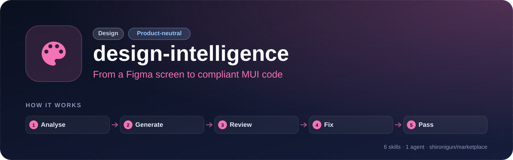
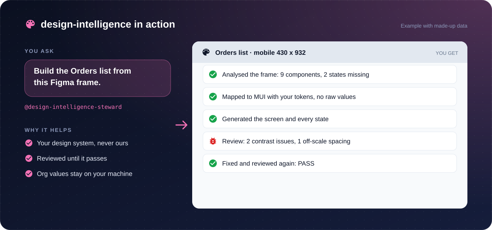
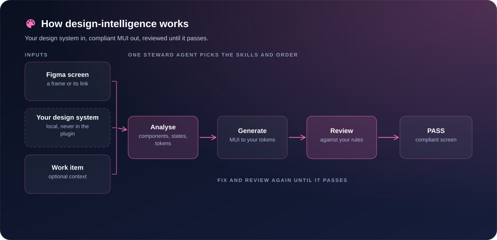

# design-intelligence

<p align="center">
  
</p>

<p align="center">
  <a href="../../README.md#the-catalog">← All plugins</a> ·
  <a href="#install">Install</a> ·
  <a href="../../README.md#trust--safety">Trust &amp; safety</a>
</p>

| At a glance | |
|---|---|
| **Category** | Design |
| **What it does** | Turns a Figma screen into an MUI implementation (or a Figma screen) and reviews it against your design system |
| **Includes** | 6 skills, 1 agent, 3 deterministic tools |
| **Writes** | Code in your project; a Figma screen only when you ask for one |
| **Setup** | Node.js (`npx`), Python 3; optional `ADO_ORG` |
| **Product-neutral** | Yes — your design system lives in a local, git-ignored overlay |

## See it in action

<p align="center"></p>

## How it works at a glance

<p align="center"></p>

An AI design-system layer that turns a Figma screen into a compliant MUI
implementation and reviews it against the organization's design system — grounded
at every step in the organization's own design knowledge, never generic design
knowledge.

This plugin **bundles six skills** plus their shared knowledge and configuration.
The six plugin capabilities below are **use cases composed from those skills** and
three deterministic tools.

## Architecture

```text
Figma
 ↓
figma-design-analysis      (extract + tag: CONFIRMED / INFERRED / UNKNOWN / CONFLICT)
 ↓
figma-to-code              (map to org system → implementation specification)
 ↓
design-system-generation   (build MUI + manifest; tokens re-decided from _shared)
 ↓
design-system-review       (judge → PASS / FAIL + cited findings)
 ↓
Correction                 (fix genuine defects → re-generate)
 ↓
Final Review               (→ PASS)
```

A parallel path builds a Figma screen instead of code:
`figma-design-analysis → figma-screen-generation → design-system-review`.

Validated end-to-end on two real screens (one web, one mobile) — both reached
FAIL → correction → PASS. The run record shipped in
`capabilities/documentation/examples/` is a fictional example of that output.

## Skills (6)

| Skill | Role | Authority |
|---|---|---|
| `figma-design-analysis` | Read-only Figma extraction → structured, evidence-tagged analysis | Sole Figma-extraction authority |
| `figma-to-code` | Adapter: analysis → implementation specification for Generation | Adaptation only (no build/verdict) |
| `design-system-generation` | Build the MUI implementation + manifest from org knowledge/config | Sole code-implementation authority (frozen) |
| `figma-screen-generation` | Build a finished Figma screen + the same manifest via the Figma MCP write tools | Sole Figma-screen authority |
| `design-system-review` | Evaluate the artifact vs system + intent → PASS/FAIL + findings | Sole compliance/verdict authority (frozen) |
| `skill-maintenance` | Safely maintain the skill library; hard-stops on frozen-skill/architecture changes | Platform/infrastructure (outside the pipeline) |

The **`design-intelligence-steward`** agent orchestrates them: it picks the route,
checks connectors, passes each skill's output forward intact, and always runs
review after any build until PASS.

`design-system-generation` carries its own knowledge alongside it:
`typography.md`, `colors.md`, `alerts.md`, `component-guidelines.md`.

## Your design system stays local

The plugin ships the **method** and an **illustrative example design system**
(fictional palette, an example font, a short sample icon map) so every file has a
worked shape. Your organization's real values never live in the plugin. They live
in a **local, git-ignored overlay** in the project you work in:

```text
.claude/design-intelligence/
  sources.md                  where your design system lives (design.md files / knowledge base,
                              Figma library + Icons component, theme file)
  config/                     token-resolution.md, required-states.md
  knowledge/                  icons.md, icons.json
  generation/                 typography.md, colors.md, alerts.md, component-guidelines.md
  conflict-aliases.json       optional, for impact analysis
  runs/                       documentation run records
```

Each skill that reads org values starts with **Step 0**: it loads the overlay. On
the first run, when there is no overlay yet, it builds one itself: a read-only scan
finds your MUI theme, design docs, Storybook, the icons you use and your Figma links,
reads the component library and `Icons` component in Figma when that connector is on,
and drafts every overlay file with its source. You confirm once (it asks only about
what it could not find), it writes the overlay and adds it to `.gitignore`, and every
later run just reads it. Running on the
bundled example is possible for a trial, and is then logged as an assumption. Full
rules: [`_shared/config/org-design-system.md`](_shared/config/org-design-system.md).

Add this line to your project's `.gitignore` (Step 0 offers to do it for you):

```text
.claude/design-intelligence/
```

## Shared knowledge & configuration (`_shared/`)

Read by the skills; never duplicated into them.

- **`_shared/knowledge/`** — `mui-reference.md` (MUI v7.3.11 component APIs,
  variants, theming, v7-vs-v9 notes, accessibility mechanisms), the icon mapping
  (`icons.md` + `icons.json`, example), and a knowledge index. MUI framework facts
  are kept separate from org design values.
- **`_shared/config/`** — the cross-skill contract: `org-design-system.md` (the
  overlay and Step 0), `manifest-schema.md` (Generation↔Review manifest, instance
  IDs, `(mui-auto)` states), `required-states.md`, and `token-resolution.md`
  (token→value map, radius rule, spacing, touch targets, contrast thresholds,
  MUI-default detection, platform switch). Org values are platform-aware (web vs
  mobile), never merged.
- `_shared/SKILL-ARCHITECTURE.md` — the frozen architecture map (referenced by
  `skill-maintenance`).

## The six capabilities

| Capability | Implementation |
|---|---|
| **Compliance Review** | `design-system-review` + `_shared/config` (tokens/states/contrast) |
| **Design Review** | `figma-design-analysis` + `design-system-review` |
| **Implementation Assistant** | `figma-to-code` + `design-system-generation` (or `figma-screen-generation` for a Figma deliverable) |
| **Documentation Generation** | `capabilities/documentation/gen_docs.py` composes analysis + manifest + review into evidence-tagged docs (+ a run index) |
| **Impact Analysis** | `capabilities/impact-analysis/impact.py` traces DIRECT/INDIRECT/POTENTIAL/UNKNOWN references, evidence-only |
| **Knowledge-Base Search** | `capabilities/knowledge-search/kb_search.py` searches the overlay and `_shared`, returns source+section+snippet or `NO_KNOWLEDGE_FOUND` |

See [`capabilities/README.md`](capabilities/README.md) for how each tool composes
the skills and `_shared`.

**Why the split.** Documentation Generation, Impact Analysis, and Knowledge-Base
Search are deterministic plugin tooling — not `SKILL.md` files — because they
transform already-produced structured outputs (run records), trace references,
and search shared knowledge, rather than performing new design reasoning. They
are dependency-free and **never fabricate**: missing data stays `UNKNOWN`,
conflicts stay `[CONFLICT]`, absent knowledge returns `NO_KNOWLEDGE_FOUND`, and
screen/artifact impact without an indexed run returns
`UNKNOWN / INSUFFICIENT INDEX DATA`.

## Install

```text
/plugin install design-intelligence --marketplace shironigun/marketplace
```

## Use

Ask the steward, or name a skill:

```text
Build this Figma screen in our app: https://www.figma.com/design/<fileKey>/<name>?node-id=<nodeId>
Review the order-summary component in src/features/orders against our design system.
What touch-target size does our design system require on mobile?
```

## Requirements

- Node.js (for `npx`) and Python 3 (for the three tools; no extra packages).
- **Figma**: a Figma account; you sign in on first use.
- **MUI docs**: no setup. `MUI_RECIPES_API_KEY` in your environment only if you
  want the MUI code-generation tool.
- **Azure DevOps** (optional, read-only work-item context): set **`ADO_ORG`** to your
  organization's short name in the shell that launches Claude Code, then restart
  the session. You sign in interactively; no token or PAT.
- Optional: your organization's knowledge-base MCP server (none is pre-configured).

## MCP servers

`.mcp.json` starts three servers with `npx`, each pinned to an exact version:
Figma's hosted endpoint via the mcp-remote bridge (`mcp-remote@0.16.7`), `@mui/mcp@0.1.10`, and
Microsoft's official `@azure-devops/mcp@2.11.0` (org from `${ADO_ORG}`, interactive sign-in). Details and
the availability rules the skills follow are in [`CONNECTORS.md`](CONNECTORS.md).

**Windows (native, not WSL):** if a server fails with "executable not found", wrap
the launcher in your local copy of `.mcp.json`: `"command": "cmd"` with
`"args": ["/c", "npx", "-y", ...]` followed by the same pinned package and
arguments. macOS, Linux and WSL use the file as shipped.

### Use your own MCP server instead

If you prefer one server of each kind shared across all your plugins, register them once at user
scope. Your org name then lives only in your own `~/.claude.json`, never in a repo:

```bash
claude mcp add --scope user figma -- npx -y mcp-remote@0.16.7 https://mcp.figma.com/mcp
```

```bash
claude mcp add --scope user mui-mcp -- npx -y @mui/mcp@0.1.10
```

```bash
claude mcp add --scope user ado -- npx -y @azure-devops/mcp@2.11.0 <your-org> --authentication interactive
```

Keep these exact server names (`figma`, `mui-mcp`, `ado`) so the skills and the steward agent recognise
the tools. When both your server and the bundled one exist, Claude Code connects once.

## Roadmap

Next up: creating a component library from an existing codebase (measure the real UI, propose a standard,
publish Storybook and Figma libraries, audit over time). See [`ROADMAP.md`](ROADMAP.md).

## Safety

- Figma analysis and work-item lookups are read-only. Figma writes happen only in
  `figma-screen-generation`, into the target you name, never over unrelated frames.
- The overlay is written only after you approve the draft; org values, Figma keys
  and run records never go into the plugin folder.
- No secrets in any file; sign-in is your own.

## Design principle

Component concepts and design-system domains (button, card, tabs, alert, MUI,
typography, colors, accessibility, responsive, …) belong primarily in the
**shared knowledge layer**, or as **dimensions inside `design-system-review`** —
not as separate skills. Accessibility and the review sub-dimensions (visual, UX,
interaction, state, responsive) are dimensions of `design-system-review`. **New
skills should only be introduced when testing demonstrates a genuine capability
gap** — a capability with its own distinct input, workflow, output, and
authority that no existing skill can reasonably handle.

## Contributors

Core contributors and co-authors of this plugin:

| Contributor | GitHub | Contact |
|---|---|---|
| Ayesha Imtiaz | [@aishaimt002](https://github.com/aishaimt002) | ayeshadis222@gmail.com |
| shironigun | [@shironigun](https://github.com/shironigun) | shironigun@gmail.com |
