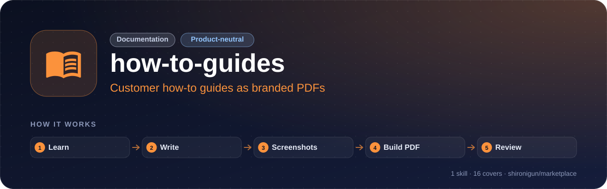
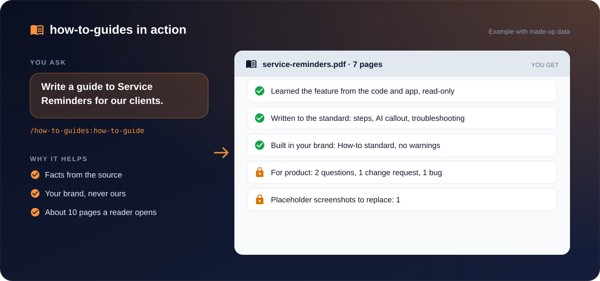
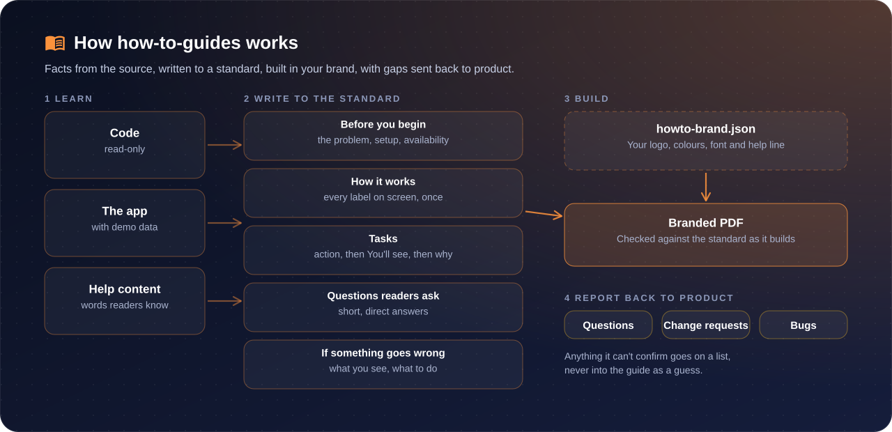
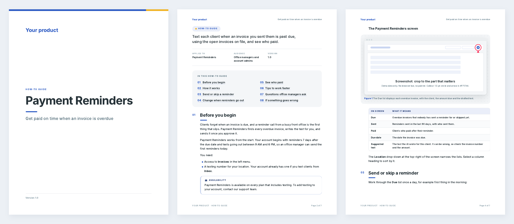

# how-to-guides

<p align="center">
  
</p>

<p align="center">
  <a href="../../README.md#the-catalog">← All plugins</a> ·
  <a href="#install">Install</a> ·
  <a href="../../README.md#trust--safety">Trust &amp; safety</a>
</p>

| At a glance | |
|---|---|
| **Category** | Documentation |
| **What it does** | A complete customer how-to guide for one feature, as a branded PDF |
| **Includes** | 1 skill |
| **Writes** | A PDF on your machine |
| **Setup** | Node.js, Chrome |
| **Product-neutral** | Yes |

## See it in action

<p align="center"></p>

## How it works at a glance

<p align="center"></p>

<p align="center"></p>


Customer how-to guides for B2B software, written to a standard and built as branded PDFs.

Say "write a guide for the reminders feature for our clients" and the `how-to-guide` skill writes the
complete guide for one feature: the reader's problem, how the feature works, every task as checked steps,
the questions readers ask, and what to do when something goes wrong. It's made for the people who use
B2B software at work, such as a service desk at a business, a front office or an account admin, who
read a guide once and come back to it for one task.

## Install

```
/plugin install how-to-guides --marketplace shironigun/marketplace
```

Then ask for a guide, or run `/how-to-guides:how-to-guide`.

## What you get

- **A researched standard** (`references/standard.md`): problem first, one How it works section, three-part
  steps (action, "You'll see", why), help finding things on screen, availability callouts, an AI callout
  for AI features, who a message to a customer comes from, a troubleshooting table, and about 10 pages
  after the cover. It joins DITA, the Microsoft and Google style guides, Diátaxis and minimalism with
  lessons from two rounds of review by a support team that writes a knowledge base.
- **Facts from the source.** The skill reads the code and the app read-only before it writes a sentence,
  and hands you three lists: questions for product, change requests for product (setup that could have
  defaults, gaps the guide has to work around) and bugs.
- **A branded PDF.** `scripts/build.mjs` turns the Markdown into a tagged, bookmarked Letter PDF through
  your local Chrome: a cover, a contents list, numbered sections and steps, callouts, framed and numbered
  screenshots, and a closing help line. It checks the guide against the standard as it builds.
- **Screenshots with demo data.** `scripts/shots/drive.mjs` clicks through a local build and saves sharp
  crops; it refuses a host that isn't local unless you say otherwise. `callout.py` draws the red circle and
  arrow.

## Your brand stays yours

The plugin ships no brand, logo or product name. Put a `howto-brand.json` at the top of your guides
folder:

```json
{
  "product": "Your product",
  "logo": "brand/logo.png",
  "colors": { "primary": "#2b59c3", "accent": "#f0b323" },
  "font": { "family": "Your Font", "file": "brand/your-font.woff2" },
  "cover": "rings",
  "help": "**Still stuck?** Select the chat button in the app to reach our support team.",
  "rules": "brand/house-rules.md"
}
```

Every guide below that folder builds in your colours, and the skill reads your house rules (what your
readers are called, your plans and platforms, where the code lives, your demo kit) after the standard.
Without a profile, guides build with a neutral look. See `skills/how-to-guide/references/brand-profile.md`.

## Requirements

- Node.js 18 or later, and Google Chrome (the build prints through it).
- Run `npm ci` once in `skills/how-to-guide/scripts/`; the skill does this when `node_modules` is missing.
- Python with Pillow, only for drawing screenshot callouts.

## Build a guide by hand

```powershell
node skills/how-to-guide/scripts/build.mjs path/to/guide.md
node skills/how-to-guide/scripts/build.mjs path/to/guide.md --covers   # a catalog of cover styles
```

## Safety

- Read only: the skill never edits, commits or switches branches in your product's code to write a guide.
- Demo data only in screenshots, never production.
- Guides are drafts until your support team reviews them; the skill never sends or publishes them.
