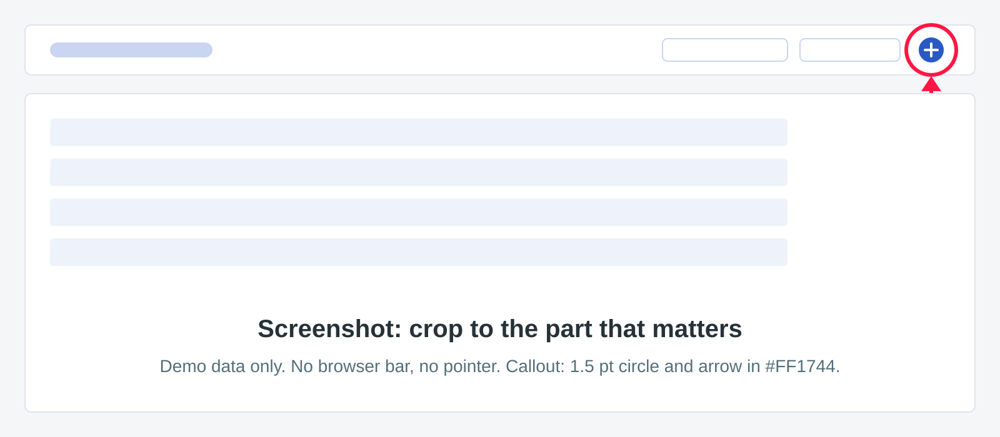

## Before you begin

Two sentences: the reader's problem in their own words, then how this feature fixes it.

You need:

- Access to the screen, or the permission that can do this.
- Anything that must be set up first, and who sets it up. If it comes with defaults, say what works without any setup.

> [!AVAILABILITY]
> Available on the Pro and Enterprise plans. Not available on the Starter plan at this time.

> [!AI]
> Feature name is an AI feature. Its suggestions can be wrong, so say what to check before acting. Then say who stays in control: what it does on its own and what it never does. Delete this callout for a feature with no AI.

## How it works

What the feature does for the business and where its information comes from. Explain every label on screen here, once, so the task sections stay pure steps.

### A term readers need to understand

What it means, what it includes and what it doesn't. A line like "It doesn't include invoices" saves a call to support.

| On screen | What it means |
| --- | --- |
| **Label** | What it displays and how it's worked out. |

The **Location** and **Team** drop-downs at the top-right of the screen narrow every number on it. Put choices that only change a view, like filters and sorting, in a short note like this one, not in the steps.

## Verb the first task

One line on when you do this task, ending with a colon:

1. Select **Area** in the left menu, then the **Tab name** tab.
2. Select the plus sign button at the top-right of the list, next to **Search**.

   You'll see the **Drawer title** drawer open on the right.

3. In **Field name**, enter the value. This is what customers see first.
4. *Optional:* Turn on **Setting** to do something extra.
5. Select **Save**.

   You'll see the new item at the top of the list.

> [!WARNING]
> What people get wrong in the step before, how they notice, and how to fix it.

## Verb the second task

When small tasks happen in the same place, keep them in one section with a heading for each.

### The first way to do it

When the reader picks this way, in the business's terms, by text, by phone or in person:

1. Open the item and select **Button**.
2. Under **Section**, choose one:
   1. **Option A**: when to pick it.
   2. **Option B**: when to pick it.

   You'll see a message confirming it worked, with **Undo**.

> [!DONE]
> What the reader sees when the whole task worked, and where to find the result later.

### The second way to do it

A short paragraph is enough for a one-step task: select **Button** on the item's row, and say where it goes.

## Tips to work faster

- One habit that saves time.

## Questions readers ask

**A question in the reader's words?**
A short, direct answer.

**Does it do this on its own?**
Say plainly what happens without anyone acting, and what only happens when a person acts.

**Who will the customer see it from?**
For anything sent to a customer, say whose name or number it goes out under.

## If something goes wrong

| What you see | What to do |
| --- | --- |
| **The exact message on screen.** | The cause in a few words, then the fix. |
| The symptom, in the reader's words | The cause in a few words, then the fix. |

## Next steps

- [Verb the related task](https://example.com/help/related-task)
