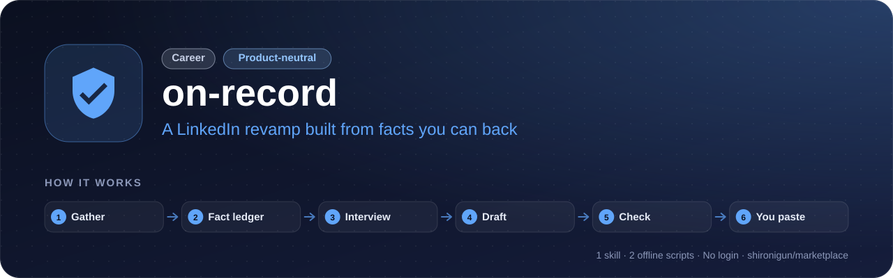
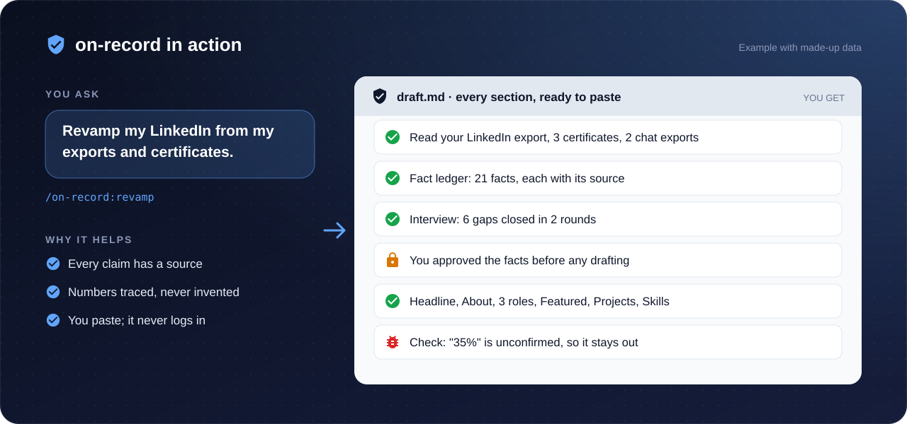
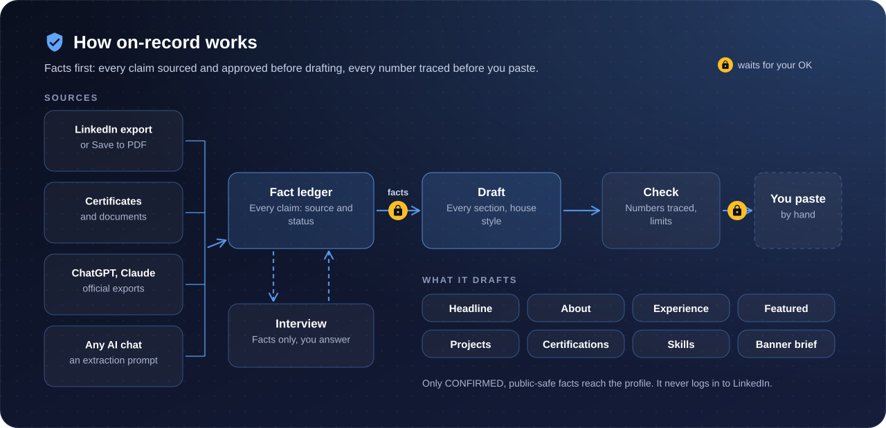

# on-record

<p align="center">
  
</p>

<p align="center">
  <a href="../../README.md#the-catalog">← All plugins</a> ·
  <a href="#install">Install</a> ·
  <a href="../../README.md#trust--safety">Trust &amp; safety</a>
</p>

| At a glance | |
|---|---|
| **Category** | Career |
| **What it does** | A full LinkedIn profile revamp, drafted from facts you can back |
| **Includes** | 1 skill |
| **Writes** | A fact ledger and a draft in a folder you choose; you paste into LinkedIn |
| **Setup** | Node.js 18 or later |
| **Product-neutral** | Yes |

## See it in action

<p align="center"></p>

## How it works at a glance

<p align="center"></p>

Revamp anyone's LinkedIn profile into a branded, enterprise one, built only from facts they can back: it
reads the LinkedIn export, certificates and ChatGPT or Claude exports, keeps a sourced fact ledger,
interviews for gaps, then drafts every section and a banner brief. Checked against the ledger and
LinkedIn's limits; the user pastes, nothing is automated.

Say "revamp my LinkedIn" and the `revamp` skill builds your profile from your own record, not
from a template. Nothing goes on the profile that you cannot back.

## Install

```
/plugin install on-record@shironigun
```

Then ask for a revamp, or run `/on-record:revamp`.

## What you get

- **A fact ledger.** Every claim gets a row with its source and a status: CONFIRMED, UNCONFIRMED or
  PLANNED, plus whether it is public-safe. Only CONFIRMED, public-safe facts reach the profile.
- **An interview, not a form.** Rounds of up to five questions about facts: what changed, how you know,
  over what period, what your part was, and who else did the work. The skill chooses the wording.
- **The whole profile, drafted**: three headline options, About, every Experience entry, Featured,
  Projects, Certifications, Skills, and two or three banner variants as a brief.
- **A check before you paste.** `scripts/check.mjs` traces every number in the draft to a confirmed fact,
  blocks unconfirmed, planned and internal facts, enforces LinkedIn's limits (Unicode bold counts double, as
  LinkedIn counts it), and flags em dashes, accented "Resume", invisible characters and link-style titles.

## Where the facts come from

| Source | How |
|---|---|
| Your current profile | The LinkedIn data export (Settings & Privacy, Data privacy, Get a copy of your data), Save to PDF, or pasted sections |
| Proof | Certificates, your resume, slides, award emails, a portfolio |
| ChatGPT and Claude | Their official data exports, searched offline with `scripts/chats.mjs` |
| Any other AI chat | A copy-paste extraction prompt you run inside each chat and project |

There is no API for consumer chat history, so the plugin never pretends to have one. A fact from a chat
starts as UNCONFIRMED, because a chat is memory, not proof.

## The house style

An identity hook, then short sections with bold headings, ▪ for what you did and ✔ for results. Experience
in resume voice, a verified result in each bullet, recognition and certifications under their own headings.
Attachments titled as the item itself, never "My post on...". Banners always on a gradient, each variant
with different facts. Plain words, no em dashes, "Resume" without accents, and credit for the people who did
the work. The full rules are in `skills/revamp/references/house-style.md`.

## Optional companion

A humanizer, such as the one in the separate `linkedin-agent` plugin, makes a good last pass on each
section; the skill runs one if your session offers it. Profile scorers often recommend a short,
second-person About; this plugin writes a longer, sectioned About on purpose, so expect that item to score
differently.

## Safety

- **It never touches LinkedIn.** No login, no scraping, no browser automation: those break LinkedIn's User
  Agreement and risk the account. You paste every section yourself.
- **Two gates.** You approve the facts before anything is drafted, and each section before it is final.
- **Your data stays local.** The ledger and draft live in a folder you choose, outside any repository. The
  scripts are offline: they read files and print to your terminal.
- **Ships no personal data.** The example is illustrative: a made-up person at a made-up company.

## Files

```
skills/revamp/
  SKILL.md                         the workflow and its two gates
  references/sources.md            LinkedIn export, Save to PDF, certificates, chat exports
  references/extraction-prompt.md  the copy-paste prompt for any AI chat
  references/interview.md          how to ask, questions for every result, the approval gate
  references/house-style.md        every section's style, LinkedIn's limits, the banner rules
  examples/ledger.md               a finished fact ledger (made-up person)
  examples/draft.md                the matching draft, which passes the check
  scripts/chats.mjs                list and search ChatGPT and Claude exports, offline
  scripts/check.mjs                check a draft against its ledger
  scripts/test/                    node --test scripts/test/scripts.test.mjs
```
