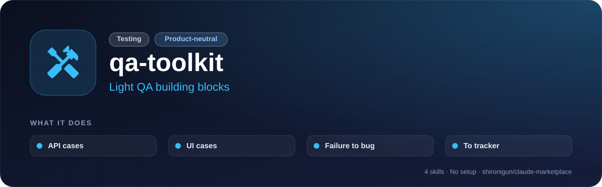

# QA Toolkit

<p align="center">
  
</p>

<p align="center">
  <a href="../../README.md#the-catalog">← All plugins</a> ·
  <a href="#install">Install</a> ·
  <a href="../../README.md#trust--safety">Trust &amp; safety</a>
</p>

| At a glance | |
|---|---|
| **Category** | Testing |
| **What it does** | API cases, UI cases, a failure turned into a bug, cases pushed to a tracker |
| **Includes** | 4 skills |
| **Writes** | Test Cases in your tracker (Azure DevOps, Jira, Linear and more) |
| **Setup** | None; a tracker connector only to push cases |
| **Product-neutral** | Yes |


QA workflow automation for Claude Code — generate API and UI test cases,
convert failures to bug reports, and push test cases to your tracker.

Four independent jobs, each a single skill. Use one, or chain them: write cases, push them to your tracker,
and turn a red API run into a bug. For the whole loop in one orchestrator, with a framework build and gated
publishing, see **[qa-engineering](../qa-engineering/)**.

## Skills

| Skill | Trigger | Description |
|---|---|---|
| `api-failure-to-bug` | `/qa-toolkit:api-failure-to-bug` | Convert an API failure into a structured bug report |
| `api-test-cases` | `/qa-toolkit:api-test-cases` | Generate test cases from an API spec or response |
| `testcase-to-tracker` | `/qa-toolkit:testcase-to-tracker` | Push generated test cases to your bug/issue tracker |
| `ui-test-cases` | `/qa-toolkit:ui-test-cases` | Generate UI test cases from a screen or user flow |

## Works with your tracker

The skills are tool-agnostic: they name a category (`~~tracker`) instead of a product, so the same skill works
with Azure DevOps, Jira, Linear, Asana, GitHub Issues, Monday or ClickUp. Only **testcase-to-tracker**
(creates Test Case work items) and **api-failure-to-bug** (drafts a Bug you then file) touch a tracker;
**ui-test-cases** and **api-test-cases** need no connector. See [CONNECTORS.md](CONNECTORS.md).

## Install

Add the marketplace first:

```bash
claude plugin marketplace add shironigun/claude-marketplace
```

Then install this plugin:

```bash
claude plugin install qa-toolkit@shironigun
```

## Usage

In any Claude Code session, invoke a skill by name:

```
/qa-toolkit:api-test-cases
```
