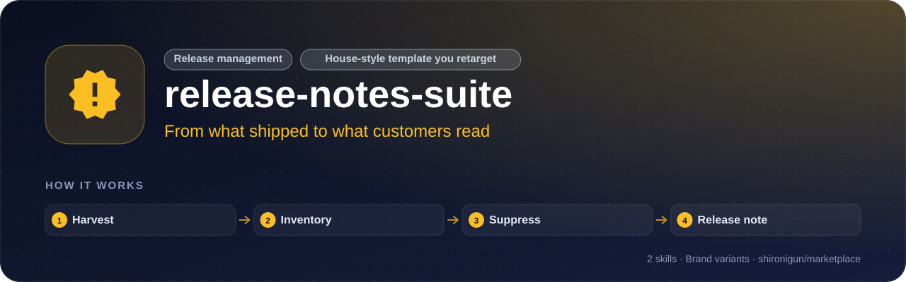

# release-notes-suite

<p align="center">
  
</p>

<p align="center">
  <a href="../../README.md#the-catalog">← All plugins</a> ·
  <a href="#install">Install</a> ·
  <a href="../../README.md#trust--safety">Trust &amp; safety</a>
</p>

| At a glance | |
|---|---|
| **Category** | Release management |
| **What it does** | A complete release inventory, then short benefit-led release notes |
| **Includes** | 2 skills |
| **Writes** | Nothing outside the session: an inventory and drafts |
| **Setup** | An Azure DevOps connection to harvest |
| **Product-neutral** | Template: retarget the skills |


A two-stage pipeline for turning what engineering shipped into client-facing release notes for **Acme CRM / Acme Notify** (Acme).

```
harvester  ->  releaser  ->  Acme Notify note + Acme CRM note
(gather all)   (suppress + write)     (brand variants)
```

## Skills

- **harvester** — builds the *complete* engineering release inventory for a date window or an initiative (e.g. "DMS-A Two-Way Sync"). Pulls User Stories, Bugs and Defects across **both** the CRM Team and Production Support boards, plus the git layer (merged PRs / commits / deployments), and deliberately catches work that shipped with **no linked ticket**. Output is the internal, exhaustive, grouped inventory — the raw material for notes. This is the opposite discipline to `releaser`: completeness, not curation.
- **releaser** — turns an inventory or a technical draft into the short, benefit-led client note in the support lead / support-team house style, deciding what to announce vs. suppress. Emits **Acme Notify** (DMS-A-facing brand) and **Acme CRM** variants from one run; branding is a profile, not a separate skill.

## How releaser decides what customers read

The heart of `releaser` is suppression, not prose. Every shipped item lands in one of four buckets:

| Bucket | What goes there | In the note |
|---|---|---|
| **Announce** | A net-new thing a client can *do*, or a change they will visibly feel | A short benefit-led block, named by what the client can now do |
| **Fold in** | Real work with no crisp new action, such as performance | At most one upbeat line |
| **Omit** | Bug fixes that make the announced feature work, plumbing, rare edge cases, anything clients already assume works | Nothing |
| **Defer to KB** | True and useful, but too deep for the note | A pointer to the knowledge base |

When nothing lands in **Announce**, "there isn't enough to announce this week" is a valid answer.

## Use it

- **Pull from the tracker:** "what did we ship since the last notes?" or "round up everything released for X
  between these dates". `harvester` builds the inventory; `releaser` triages it and drafts the note.
- **Transform a draft:** paste a technical draft, a flow doc, a changelog or a ticket and say "turn this into
  release notes". `releaser` skips straight to triage.

## Safety

- Read-only: `harvester` reads work items, PRs and commits through your Azure DevOps connection and never
  changes them. When a source is unreachable it says so instead of faking completeness.
- Drafts only: every note is shown to you for sign-off and is never published by the plugin.

## Install

```bash
claude plugin marketplace add shironigun/claude-marketplace
claude plugin install release-notes-suite@shironigun
```

To pull from the tracker, connect an Azure DevOps MCP server in your session. Transforming a pasted draft
needs no setup.

## Install note

If you already have the standalone `releaser` skill installed, remove it after installing this suite so you don't run two copies. The suite's `releaser` is the maintained version (adds brand variants).
