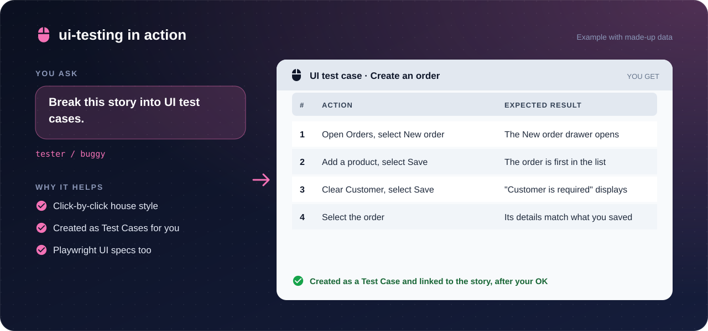
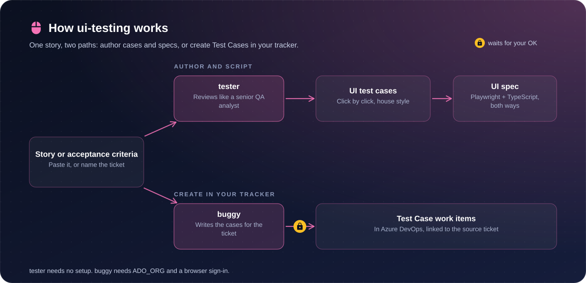

# ui-testing

<p align="center">
  
</p>

<p align="center">
  <a href="../../README.md#the-catalog">← All plugins</a> ·
  <a href="#install">Install</a> ·
  <a href="../../README.md#trust--safety">Trust &amp; safety</a>
</p>

| At a glance | |
|---|---|
| **Category** | Testing |
| **What it does** | Click-by-click UI cases and runnable Playwright UI specs |
| **Includes** | 2 skills |
| **Writes** | Test Case work items (`buggy`, after your OK) |
| **Setup** | `az login` + `AZURE_DEVOPS_ORG_URL`, for `buggy` only |
| **Product-neutral** | Yes: org facts come from a local workspace profile |

## See it in action

<p align="center"></p>

## How it works at a glance

<p align="center"></p>


UI test-case authoring and Playwright + TypeScript UI-script generation for any web product,
in a rigorous senior-QA house style.

| Skill | What it does | Writes to ADO? |
|---|---|---|
| **buggy** | Writes click-by-click **UI Test Cases** for a ticket in the house style **and creates them as Test Case work items in Azure DevOps**, linked to the source ticket. | **Yes** (needs the MCP below) |
| **tester** | Reviews a story / AC as a senior SQA analyst and authors UI test cases (and generates/parses runnable Playwright + TypeScript UI specs, forward and reverse). Authoring + script generation only. | No — produces cases/scripts as output |

Trigger either by pasting a ticket / story / AC and asking for UI test cases or scripts — e.g.
"write tests for #1001", "break this story into UI test cases", "generate the Playwright spec for this".

## Workspace profile (your org facts stay local)

Neither skill ships any org's facts. On first run each skill reads (or discovers, read-only, and asks you
to confirm) a local **workspace profile** at `.claude/workspace-profile.json` in your project: tracker
org/project, board area paths, the filer's identity, environments, module names, client-id format and
integration partners. It is git-ignored and never committed; later runs reuse it silently. The schema is
in each skill's `references/workspace-profile.md`.

## Setup — self-contained, no secrets (only `buggy` needs it)

`buggy` **creates Test Case work items in Azure DevOps**, so the plugin **bundles** the `azure-devops` MCP
server (in its `.mcp.json`) and authenticates with **Azure Identity** — **no PAT or token lives in the repo
or is required**. (`tester` needs nothing — it only produces cases and script text.) Just once:

1. **`az login`** (Azure CLI) with an account that can create work items on the project.
2. Set **`AZURE_DEVOPS_ORG_URL`** in your environment to your org, e.g.
   `export AZURE_DEVOPS_ORG_URL=https://dev.azure.com/<org-name>` (PowerShell:
   `$env:AZURE_DEVOPS_ORG_URL = "https://dev.azure.com/<org-name>"`). The bundled `.mcp.json` reads it via
   `${AZURE_DEVOPS_ORG_URL}`; no org is hardcoded.
3. Install the plugin (below) and start or reload the session — the `azure-devops` server starts
   automatically; confirm it in `/mcp`.

**Windows:** if the server fails to start because `npx` is not found as an executable, change the
launcher in the plugin's `.mcp.json` from `"command": "npx", "args": ["-y", …]` to
`"command": "cmd", "args": ["/c", "npx", "-y", …]`.

> Nothing sensitive is committed — auth is your `az login` session (Azure Identity), never a PAT in a file.
> `buggy` always asks for your approval before creating work items — ADO creation is a real write.

## Install

```bash
claude plugin marketplace add shironigun/marketplace
claude plugin install ui-testing@shironigun
```

Then run `az login` and set `AZURE_DEVOPS_ORG_URL` if you plan to use `buggy` (the bundled MCP handles the rest — see Setup above).

## Notes

- Product-neutral: org facts (project, area paths, identity, title conventions) come from the workspace
  profile, and the examples in each skill's `references/` use fictional placeholders.
- Optional companion plugins in this marketplace: **api-testing** (the request/response equivalent) and
  **bug-suite** (filing Bugs/Defects). For the full QA loop in one orchestrator, see **qa-engineering**.
