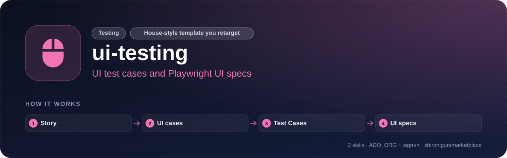

# ui-testing

<p align="center">
  
</p>

<p align="center">
  <a href="../../README.md#the-catalog">← All plugins</a> ·
  <a href="#install">Install</a> ·
  <a href="../../README.md#trust--safety">Trust &amp; safety</a>
</p>

| At a glance | |
|---|---|
| **Category** | Testing |
| **What it does** | Click-by-click UI cases and runnable Playwright UI specs |
| **Includes** | 2 skills |
| **Writes** | Test Case work items (`buggy`, after your OK) |
| **Setup** | Set `ADO_ORG`; browser sign-in on first use, for `buggy` only |
| **Product-neutral** | Yes: org facts come from a local workspace profile |

## See it in action

<p align="center"></p>

## How it works at a glance

<p align="center"></p>


UI test-case authoring and Playwright + TypeScript UI-script generation for any web product,
in a rigorous senior-QA house style.

| Skill | What it does | Writes to ADO? |
|---|---|---|
| **buggy** | Writes click-by-click **UI Test Cases** for a ticket in the house style **and creates them as Test Case work items in Azure DevOps**, linked to the source ticket. | **Yes** (needs the MCP below) |
| **tester** | Reviews a story / AC as a senior SQA analyst and authors UI test cases (and generates/parses runnable Playwright + TypeScript UI specs, forward and reverse). Authoring + script generation only. | No — produces cases/scripts as output |

Trigger either by pasting a ticket / story / AC and asking for UI test cases or scripts — e.g.
"write tests for #1001", "break this story into UI test cases", "generate the Playwright spec for this".

## Workspace profile (your org facts stay local)

Neither skill ships any org's facts. On first run each skill reads (or discovers, read-only, and asks you
to confirm) a local **workspace profile** at `.claude/workspace-profile.json` in your project: tracker
org/project, board area paths, the filer's identity, environments, module names, client-id format and
integration partners. It is git-ignored and never committed; later runs reuse it silently. The schema is
in each skill's `references/workspace-profile.md`.

## Setup — self-contained, no secrets (only `buggy` needs it)

`buggy` **creates Test Case work items in Azure DevOps**, so the plugin **bundles** Microsoft's official
Azure DevOps MCP server (`ado`, `@azure-devops/mcp@2.11.0`, in its `.mcp.json`), which signs in
**interactively in the browser** — **no PAT or token lives in the repo or is required**. (`tester` needs
nothing — it only produces cases and script text.) Just once:

1. Set **`ADO_ORG`** to your organization's **short name** (the `<org-name>` in
   `https://dev.azure.com/<org-name>`) in **the shell that launches Claude Code**, e.g.
   `export ADO_ORG=<org-name>` (PowerShell: `$env:ADO_ORG = "<org-name>"`), or in Claude Code's settings
   `env`. The bundled `.mcp.json` reads it via `${ADO_ORG}`; no org is hardcoded. A `.env` file does not
   work for this.
2. Install the plugin (below) and start or reload the session — the `ado` server starts automatically;
   confirm it in `/mcp`.
3. On the first Azure DevOps call a browser window opens: sign in with an account that can create work
   items on the project (and, if you want `buggy` to add cases to a suite for you, has Test Plans access).

**Windows:** if the server fails to start because `npx` is not found as an executable, change the
launcher in the plugin's `.mcp.json` from `"command": "npx", "args": ["-y", …]` to
`"command": "cmd", "args": ["/c", "npx", "-y", …]`.

> Nothing sensitive is committed — auth is your own browser sign-in, never a PAT in a file.
> `buggy` always asks for your approval before creating work items — ADO creation is a real write.

### Use your own MCP server instead

If you prefer one Azure DevOps server shared across all your plugins, register it once at user scope.
Your org name then lives only in your own `~/.claude.json`, never in a repo:

```bash
claude mcp add --scope user ado -- npx -y @azure-devops/mcp@2.11.0 <your-org> --authentication interactive
```

Keep this exact server name (`ado`) so the skills recognise the tools (`mcp__ado__<tool>`). When both your
server and the bundled one exist, Claude Code connects once.

## Install

```bash
claude plugin marketplace add shironigun/marketplace
claude plugin install ui-testing@shironigun
```

Then set `ADO_ORG` if you plan to use `buggy`, and sign in in the browser on first use (the bundled MCP handles the rest — see Setup above).

## Notes

- Product-neutral: org facts (project, area paths, identity, title conventions) come from the workspace
  profile, and the examples in each skill's `references/` use fictional placeholders.
- Optional companion plugins in this marketplace: **api-testing** (the request/response equivalent) and
  **bug-suite** (filing Bugs/Defects). For the full QA loop in one orchestrator, see **qa-engineering**.
